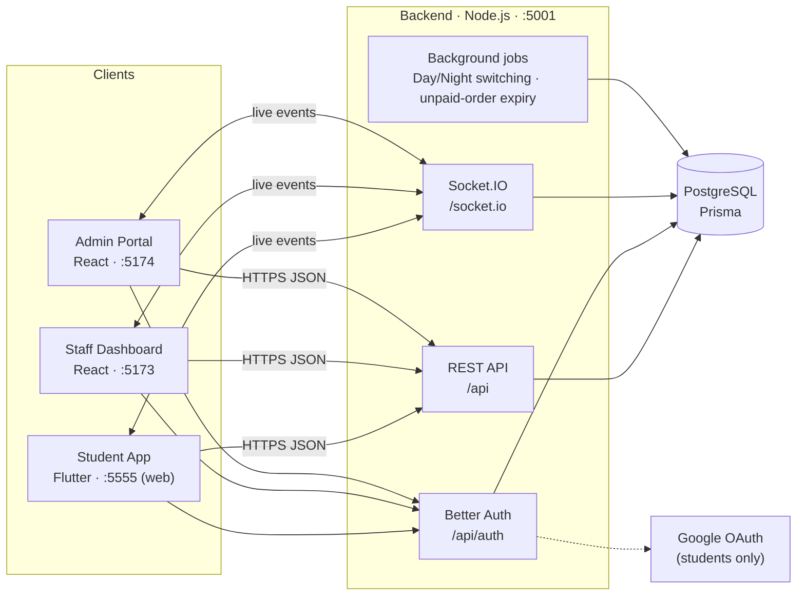
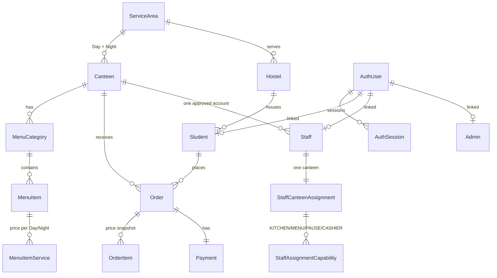

# SERVE

### Order. Track. Collect.

SERVE is a food-ordering and kitchen-operations platform for the hostel
canteens of SRM University-AP. Students order and pay from an app and follow
their order live; canteen staff run the kitchen, confirm payments and control
order intake; administrators manage canteens, staff and reports — all on one
shared backend.

> **Status:** all applications are implemented and tested locally. Not yet
> done: real online payments (Razorpay), push notifications and a public
> deployment. See [Project Status and License](#14-project-status-and-license).

---

## Table of Contents

1. [Project Overview](#1-project-overview)
2. [Features](#2-features)
3. [Technology Stack](#3-technology-stack)
4. [System Architecture](#4-system-architecture)
5. [Repository Structure](#5-repository-structure)
6. [Prerequisites](#6-prerequisites)
7. [Clone and Setup](#7-clone-and-setup)
8. [Run the Complete Application](#8-run-the-complete-application)
9. [Authentication and API](#9-authentication-and-api)
10. [Database](#10-database)
11. [Testing and Build](#11-testing-and-build)
12. [Troubleshooting](#12-troubleshooting)
13. [GitHub Contribution Guide](#13-github-contribution-guide)
14. [Project Status and License](#14-project-status-and-license)

---

## 1. Project Overview

### The problem

During peak hours, students queue in person at the hostel night canteens to
order and pay, without knowing how long the wait will be, whether the food they
want is available, or when their order is ready. Behind the counter, staff take
orders verbally, check UPI payments by hand, and have no structured way to stop
accepting orders when the kitchen is overloaded.

### How SERVE is used

| User | App | What they do |
| --- | --- | --- |
| **Student** | Student App (Flutter: web, Android, iOS) | Sign in with an SRM Google account, choose a canteen (defaults to their hostel's), order, pay by UPI, tap "I've paid", track the order live, collect it |
| **Canteen staff** | Staff Dashboard (web) | Register and wait for approval, confirm payments, move orders Preparing → Ready → Collected, manage the menu, take counter sales, pause orders |
| **Administrator** | Admin Portal (web) | Approve staff and set their permissions, manage Day/Night canteens and schedules, configure payments, view reports |

### Main benefits

- Students skip the counter queue and see availability and order status live.
- The kitchen only sees **paid** orders, and unpaid orders expire automatically.
- Staff verify UPI payments from an ordered queue instead of by memory.
- Staff can **pause** new orders when the kitchen is overloaded.
- Prices, totals and permissions are always decided by the server.

### Canteen structure

Each hostel belongs to a **service area** with one **Night** and one **Day**
canteen; only one of them takes orders at a time. The prototype's seed data
(`backend/src/db/seed.ts`):

| Hostels | Service area canteens |
| --- | --- |
| Krishna, Godavari | Krishna & Godavari Night Canteen / Day Canteen |
| Yamuna, Narmada | Yamuna & Narmada Night Canteen / Day Canteen |
| New Hostel | New Hostel Night Canteen / Day Canteen |
| Vedavathi | Vedavathi Night Canteen / Day Canteen |
| Ganga A, Ganga B | Ganga A & Ganga B Night Canteen / Day Canteen |

---

## 2. Features

Legend: ✅ Implemented · 🟡 Partially implemented · 🗓️ Planned

### Student Application (`apps/student`)

| Feature | Status |
| --- | --- |
| Google sign-in (verified `@srmap.edu.in` accounts only) and registration with hostel | ✅ |
| Home with recommendations (your most-ordered, else canteen's most popular) | ✅ |
| Menu with search, filters and live availability; Day/Night prices | ✅ |
| One-canteen cart with server-priced quote; pickup-only checkout | ✅ |
| UPI payment: canteen QR (or a labelled DEMO QR in test mode), "I've paid" with UPI reference | ✅ |
| Order number (e.g. `SV1024`) and live tracking | ✅ |
| Order history, cancellation before preparation, in-app notifications, profile | ✅ |
| Favourites and recently viewed | 🟡 Saved on the device only |
| Native Android/iOS Google sign-in | 🟡 Needs the backend on a public https URL; not tried on a real iPhone |
| Push notifications (FCM / APNs) | 🗓️ |

### Staff Dashboard (`apps/staff`)

| Feature | Status |
| --- | --- |
| Email + password sign-in; self-registration (name, any email, password, canteen) → **PENDING** until approved | ✅ |
| Dashboard with live counters; **Pause orders / Resume orders** (manual) | ✅ |
| Kitchen board (paid orders only): New → Preparing → Ready → Collected | ✅ |
| Menu management (items, prices in rupees, availability) | ✅ |
| Cashier: UPI claim queue (confirm / reject), counter sales (cash/UPI), receipts | ✅ |
| Account page with password change | ✅ |
| Automatic, capacity-based pausing | 🗓️ Not implemented — pausing is manual |

Each action requires a capability on the staff member's own canteen: `KITCHEN`,
`MENU`, `PAUSE` or `CASHIER`.

### Admin / Management Dashboard (`apps/admin`)

| Feature | Status |
| --- | --- |
| Email + password sign-in (accounts created only by `admin:create`) | ✅ |
| Dashboard: today's orders by status and channel, paused canteens, pending requests | ✅ |
| Canteens: activation, pause, Day/Night service areas, automatic schedule and overrides | ✅ |
| Payment mode per canteen (**DEMO** / **LIVE**) and official UPI QR upload | ✅ |
| Staff: approve / reject access requests, assign canteen, set capabilities, deactivate | ✅ |
| Menu catalogue and Day/Night pricing | ✅ |
| Reports: orders and sales by canteen, Day/Night, channel and payment method; top items; daily series | ✅ (daily granularity) |
| Settings page with password change | ✅ |
| Activity page | 🟡 Changes are written to server logs; no stored, searchable history |
| Online payments (Razorpay) | 🟡 Signature verification only; API calls pending |
| Demand forecasting / market intelligence | 🗓️ Not implemented |

---

## 3. Technology Stack

| Layer | Technology | Version (from the repo) | Purpose |
| --- | --- | --- | --- |
| Student app | Flutter / Dart | Flutter 3.47+, Dart `^3.13.3` | Android, iOS and web client |
| Student app libraries | provider, http, socket_io_client, flutter_secure_storage, flutter_web_auth_2 | see `apps/student/pubspec.yaml` | State, REST, realtime, secure token storage, system-browser sign-in |
| Web dashboards | React + TypeScript + Vite | React 19.3, TypeScript 6.0, Vite 8.3 | Staff Dashboard and Admin Portal |
| Routing | React Router | 7.18 | Web app navigation |
| Shared web code | `packages/web-shared`, `packages/contracts` (zod 4.6) | — | Auth, API client, realtime, UI kit; shared API types |
| Backend | Node.js + Express | Node ≥ 22.12, Express 5.2 | REST API |
| Realtime | Socket.IO | 4.8 | Live order, menu and canteen updates |
| Authentication | Better Auth | 1.7.25 | Google OAuth (students), email + password (staff, admins), sessions |
| Database | PostgreSQL + Prisma ORM | PostgreSQL 16, Prisma 7.10 | Data storage and migrations |
| Security / logging | helmet, express-rate-limit, pino | 8.3 / 8.7 / 10.4 | Headers, rate limits, structured redacted logs |
| Tests | Vitest, Testing Library, flutter_test, Playwright | Vitest 5.0, Playwright 1.56 | Unit, integration, widget and end-to-end tests |
| Code quality | ESLint, Prettier | ESLint 10, Prettier 3.9 | Linting and formatting |
| Deployment (prepared) | Docker, Caddy / nginx | `Dockerfile`, `deploy/` | Single-domain image and reverse-proxy examples |

---

## 4. System Architecture



- **One backend** serves all three apps. Clients never access the database directly.
- **Authentication:** Better Auth issues a session stored in PostgreSQL. Web apps
  receive it as an HttpOnly cookie; the native app receives a token and sends it as
  `Authorization: Bearer`.
- **Authorization:** roles (student, staff, admin), staff approval and canteen
  permissions are read from PostgreSQL on every request.
- **Realtime:** after a change is saved, the backend pushes an event (for example
  `order.ready`) to the right rooms (that student, that canteen's staff, admins).
- **Background jobs** (in the backend process): Day/Night switching every 30
  seconds, and expiry of unpaid orders every 60 seconds (orders expire after 20
  minutes by default).

---

## 5. Repository Structure

```text
Serve-final/
├── apps/
│   ├── student/        Flutter student app (Android, iOS, web)
│   ├── staff/          React staff dashboard (Vite, port 5173)
│   └── admin/          React admin portal (Vite, port 5174)
├── backend/            Express + Socket.IO + Better Auth + Prisma
│   ├── prisma/         schema.prisma, migrations/, seed.ts
│   ├── scripts/        create-admin, set-password, seed-dev-users, db-setup-local.sh
│   ├── src/            config, lib, middleware, modules/, realtime/, app.ts, server.ts
│   └── tests/          unit + integration tests (real PostgreSQL)
├── packages/
│   ├── contracts/      Shared API schemas and TypeScript types (zod)
│   └── web-shared/     Auth, API client, realtime and UI shared by staff + admin
├── e2e/                Playwright end-to-end tests
├── docs/               Architecture, API, database, auth, development, deployment
├── deploy/             Caddy and nginx examples, production env template
├── scripts/            dev-student, build-web, smoke-deploy
├── brand/              Official SERVE logo and palette
├── .env.example        Overview of all environment variables
├── Dockerfile          Optional single-domain image
└── package.json        npm workspaces (backend, packages, staff, admin, e2e)
```

The Flutter app is **not** an npm workspace; it has its own `pubspec.yaml`.

---

## 6. Prerequisites

| Software | Version | Get it |
| --- | --- | --- |
| Git | any recent | <https://git-scm.com/downloads> |
| Node.js (includes npm) | **22.12 or newer** (`.nvmrc`: 22) | <https://nodejs.org/> |
| PostgreSQL | **16** (includes `psql`) | <https://www.postgresql.org/download/windows/> |
| Flutter SDK | **3.47 or newer** (Dart 3.13) | <https://docs.flutter.dev/get-started/install/windows> |
| Google Chrome | current | Needed for Flutter web and the E2E tests on Windows |
| VS Code | optional | <https://code.visualstudio.com/> (Flutter and ESLint extensions recommended) |
| Google Cloud account | — | Only for **student** Google sign-in (section 7.8) |

Check your installation in PowerShell:

```powershell
git --version
node --version
npm --version
psql --version
flutter --version
```

If `psql` is not found, use its full path, e.g.
`& "C:\Program Files\PostgreSQL\16\bin\psql.exe" --version`.

---

## 7. Clone and Setup

All commands are for **Windows PowerShell**, run from the repository root unless
stated otherwise.

### 7.1 Find the repository URL

On GitHub, open the repository, click the green **Code** button, choose
**HTTPS** and copy the URL. For this repository:
`https://github.com/pranathigit11/Serve-final.git`

### 7.2 Clone

```powershell
cd $HOME
git clone https://github.com/pranathigit11/Serve-final.git
cd Serve-final
```

### 7.3 Open in VS Code

```powershell
code .
```

(Or **File → Open Folder** and choose `Serve-final`.) Use **Terminal → New
Terminal** for the commands below.

### 7.4 Install dependencies

```powershell
npm ci
cd apps\student
flutter pub get
cd ..\..
```

`npm ci` installs every npm workspace from `package-lock.json`. If PowerShell
blocks `npm` ("running scripts is disabled"), run once:
`Set-ExecutionPolicy -Scope CurrentUser -ExecutionPolicy RemoteSigned`.

### 7.5 Create the environment files

```powershell
Copy-Item backend\.env.example backend\.env
Copy-Item backend\.env.example backend\.env.test
Copy-Item apps\staff\.env.example apps\staff\.env.development.local
Copy-Item apps\admin\.env.example apps\admin\.env.development.local
```

These files are gitignored. **Never commit them.**

Generate two secrets for `backend\.env` (run each line, copy the output):

```powershell
$b = New-Object byte[] 32; [Security.Cryptography.RandomNumberGenerator]::Create().GetBytes($b); [Convert]::ToBase64String($b)
$b = New-Object byte[] 32; [Security.Cryptography.RandomNumberGenerator]::Create().GetBytes($b); -join ($b | ForEach-Object { $_.ToString('x2') })
```

Edit **`backend\.env`** (`notepad backend\.env`):

| Variable | Value | Required |
| --- | --- | --- |
| `NODE_ENV` | `development` | yes |
| `PORT` | `5001` (5000 is rejected) | yes |
| `DATABASE_URL` | `postgresql://serve:<db-password>@localhost:5432/serve_dev?schema=public` | yes |
| `CORS_ORIGINS` | `http://localhost:5173,http://localhost:5174,http://localhost:5555` | yes |
| `BETTER_AUTH_URL` | `http://localhost:5001` | yes |
| `BETTER_AUTH_SECRET` | first generated value (32+ characters) | yes |
| `GOOGLE_CLIENT_ID`, `GOOGLE_CLIENT_SECRET` | from section 7.8 | for student sign-in |
| `STUDENT_APP_URL`, `STAFF_DASHBOARD_URL`, `ADMIN_PORTAL_URL` | `http://localhost:5555`, `:5173`, `:5174` | yes |
| `PAYMENT_MODE` | `mock` | yes |
| `PAYMENT_SECRET` | second generated value (64 hex characters) | yes |

Optional: `UNPAID_ORDER_EXPIRY_MINUTES` (default 20), `LOG_LEVEL`, rate limits —
see the comments in `backend\.env.example`.

Edit **`backend\.env.test`** (only for automated tests): `NODE_ENV=test`,
`PORT=5101`, `DATABASE_URL` pointing at **`serve_test`**, the same `CORS_ORIGINS`,
`PAYMENT_MODE=mock`, a different `PAYMENT_SECRET`, `LOG_LEVEL=silent`,
`RATE_LIMIT_MAX=100000`, `SENSITIVE_RATE_LIMIT_MAX=100000`. Leave
`BETTER_AUTH_SECRET` and the Google variables **empty**.

The two `apps\*\.env.development.local` files need no changes
(`VITE_API_URL=http://localhost:5001`). The student app needs no env file.

### 7.6 Configure PostgreSQL

Make sure the PostgreSQL service is running (**Services** app, or
`Get-Service postgresql*` in PowerShell; the service name depends on your
installer). Then create the role and two databases (`psql` asks for the
`postgres` password you chose when installing):

```powershell
$psql = "C:\Program Files\PostgreSQL\16\bin\psql.exe"
& $psql -U postgres -c "CREATE ROLE serve LOGIN CREATEDB PASSWORD 'choose-a-db-password';"
& $psql -U postgres -c "CREATE DATABASE serve_dev OWNER serve;"
& $psql -U postgres -c "CREATE DATABASE serve_test OWNER serve;"
```

Use the same password in `DATABASE_URL` (percent-encode `@ : / ? #` if used).
On macOS/Linux, `SERVE_DB_PASSWORD='…' npm run db:setup:local` does the same.

> `serve_test` is **wiped and rebuilt** by every backend and E2E test run. Never
> point `.env.test` at a database you care about.

### 7.7 Prisma: client, migrations and seed

```powershell
npm run prisma:generate --workspace backend
npm run prisma:migrate:deploy --workspace backend
npm run db:seed --workspace backend
```

- `prisma:generate` creates the Prisma client (not automatic in Prisma 7).
- `prisma:migrate:deploy` applies all migrations to `serve_dev`. It never resets data.
- `db:seed` adds canteens, hostels and menus. It is safe to re-run (no duplicates).

### 7.8 Authentication and accounts

**Admin account** (required; there is no public admin registration). The
password is typed at a hidden prompt (at least 10 characters):

```powershell
npm run admin:create --workspace backend -- --email your.name@example.com --name "Your Name"
```

**Student Google sign-in** (needed only for the student app) — you must create
your own Google OAuth client:

1. Open <https://console.cloud.google.com/> and create or pick a project.
2. **Google Auth Platform → Branding:** app name and support email.
3. **Audience:** *Internal* if the project belongs to the `srmap.edu.in` Google
   Workspace; otherwise *External* in *Testing* mode, with your `@srmap.edu.in`
   accounts added as test users.
4. **Clients → Create client → Web application:**
   - Authorized JavaScript origin: `http://localhost:5555`
   - Authorized redirect URI: `http://localhost:5001/api/auth/callback/google`
5. Copy the Client ID and Client secret into `backend\.env`.

Staff need no setup: they register themselves in the Staff Dashboard. Existing
staff or admins without a password can be given one with
`npm run account:set-password --workspace backend -- --role staff --email <address>`.

---

## 8. Run the Complete Application

### 8.1 Quick start

Start PostgreSQL first, then open **four PowerShell terminals in the repository
root** (VS Code: Terminal → New Terminal) and start them in this order:

| Terminal | Service | Command | URL |
| --- | --- | --- | --- |
| — | PostgreSQL | Windows service (section 7.6) | `localhost:5432` |
| 1 | Backend (API, auth, Socket.IO) | `npm run dev:backend` | <http://localhost:5001> |
| 2 | Staff Dashboard | `npm run dev:staff` | <http://localhost:5173> |
| 3 | Admin Portal | `npm run dev:admin` | <http://localhost:5174> |
| 4 | Student App (Chrome) | `npm run dev:student` | <http://localhost:5555> |

Check the backend in another terminal:

```powershell
Invoke-RestMethod http://localhost:5001/api/health
Invoke-RestMethod http://localhost:5001/api/health/db
```

Open the apps at `http://localhost:…`, **not** `127.0.0.1`.

### 8.2 Connecting the student app to the backend

| Where the app runs | Command | Backend address used |
| --- | --- | --- |
| Chrome (web) | `npm run dev:student` | `http://localhost:5001` |
| Android emulator | `npm run dev:student -- -d emulator-5554` (id from `flutter devices`) | `http://10.0.2.2:5001` (automatic) |
| Physical phone (same Wi-Fi) | `npm run dev:student -- -d <device-id> --lan` | your computer's network IP, port 5001 |
| Custom | add `--dart-define=API_URL=http://<host>:5001` | as given |

For a physical phone, allow port 5001 through Windows Firewall. **Google sign-in on
an emulator or phone** additionally needs the backend on a public https URL
registered with Google (`BETTER_AUTH_URL`, e.g. a tunnel); see
[docs/authentication.md](docs/authentication.md). If Flutter is not on your
`PATH`, set `$env:FLUTTER_BIN` to the full path of `flutter.bat`.

### 8.3 Verify the complete workflow (student → staff)

> **One browser = one session.** All apps share one sign-in cookie on
> `localhost`, so signing in to one app replaces the session in the others.
> Use a separate browser profile (or a Chrome Guest window) for each role.

1. **Admin** (profile 1): open <http://localhost:5174>, sign in with the
   `admin:create` email and password.
2. **Staff** (profile 2): open <http://localhost:5173> → **Request access**; enter
   name, any email, a password (10+ characters) and a canteen (e.g. *Krishna &
   Godavari Night Canteen (Night)*). You see **Awaiting approval**.
3. **Admin:** **Change requests → Approve**. Then open **Staff**, select the staff
   member, tick **CASHIER** and click **Save permissions** (approval grants only
   KITCHEN, MENU and PAUSE). The staff screen unlocks.
4. **Student** (profile 3): open <http://localhost:5555> → **Student → Continue
   with Google** with an `@srmap.edu.in` account; register with the hostel
   *Krishna*.
5. **Student:** add items to the cart → checkout → place order. The canteen is in
   **DEMO** mode, so a labelled test QR is shown. Tap **I've paid** — status
   becomes "Waiting for the cashier to confirm".
6. **Staff:** **Cashier** → claim queue → confirm the payment. The student sees
   **Payment confirmed**.
7. **Staff:** **Orders** → **Preparing** → **Ready** → **Collected**. The student
   sees each step live.
8. **Staff:** **Dashboard → Pause orders**. The student sees the canteen as
   **Paused** and a new order is refused. **Resume orders** to continue.
9. **Admin:** **Reports** shows the order.

If step 4 is not possible (no Google client), every other step still works; the
student flow is also covered by the automated E2E tests (section 11).

---

## 9. Authentication and API

### Sign-in methods

| Role | Method | Rules |
| --- | --- | --- |
| Student | Google OAuth only | Verified `@srmap.edu.in` accounts; registers name + hostel on first sign-in |
| Staff | Email + password only | Any address; self-registration is **PENDING** until an admin approves |
| Admin | Email + password only | Any address; created only by `npm run admin:create --workspace backend` |

The backend enforces these rules on every session, request and Socket.IO
connection: Google is refused for staff/admin addresses, and students cannot use
the password sign-in. Sessions last 7 days; passwords are hashed with scrypt;
there is no email-based password reset (use `account:set-password`).

### API structure (all under `/api`)

| Base path | Used by | Examples |
| --- | --- | --- |
| `/auth` | All | `POST /sign-in/social` (Google), `POST /sign-in/email`, `POST /change-password`, `GET /get-session`, `POST /sign-out`, `GET /me`, `POST /student/register`, `POST /staff/sign-up` |
| `/native-auth` | Mobile app | `GET /start`, `GET /finish`, `POST /exchange` |
| `/hostels`, `/service-areas` | Public | Registration lists |
| `/canteens`, `/menu` | Signed in | `GET /canteens`, `GET /canteens/:id/menu`, `GET /menu/items/:id` |
| `/cart`, `/orders` | Student | `POST /cart/quote`, `POST /orders` (Idempotency-Key header), `GET /orders/:id`, `POST /orders/:id/cancel` |
| `/payments` | Student | `GET /:orderId/payment-config`, `POST /:orderId/claim` |
| `/staff` | Approved staff | `GET /dashboard`, `PATCH /canteen/status`, `GET /orders`, `PATCH /orders/:id/status`, `GET /payments/pending`, `POST /orders/:id/confirm-payment`, `POST /pos/sales` |
| `/admin` | Admin | `GET /dashboard`, `GET /reports`, canteens, service areas, staff, `POST /change-requests/:id/approve` |
| `/notifications` | Signed in | `GET /`, `PATCH /:id/read`, `PATCH /read-all` |
| `/health` | Public | `GET /`, `GET /db` |

Errors always use `{ "error": { "code", "message", "details?", "requestId?" } }`.
Full reference: [docs/api.md](docs/api.md).

### Realtime events (Socket.IO)

`order.created`, `order.payment_confirmed`, `order.preparing`, `order.ready`,
`order.collected`, `order.cancelled`, `payment.queue_changed`,
`menu.item_updated`, `menu.item_availability_changed`, `menu.item_price_changed`,
`menu.category_updated`, `canteen.status_changed`, `canteen.payment_qr_updated`,
`service_area.updated`, `staff.approved`, `staff.rejected`,
`staff.canteen_assigned`, `staff.unassigned`, `staff.deactivated`,
`change_request.created`, `change_request.updated`, `notification.created`,
`auth.expired`. Rooms are assigned by the server; clients cannot choose them.

---

## 10. Database

PostgreSQL via Prisma (`backend/prisma/schema.prisma`, 26 models, 11
migrations). Money is stored as integer **paise**; IDs are UUIDs.



| Model | Purpose |
| --- | --- |
| `ServiceArea`, `Canteen`, `Hostel` | Areas with a Day and a Night canteen; the database allows only one to take orders at a time |
| `MenuCategory`, `MenuItem`, `MenuItemService` | Menu, with Day/Night price and availability |
| `Order`, `OrderItem` | Orders (`SV…` numbers, idempotency key) and immutable item snapshots |
| `Payment` | Payment status, UPI claim (`claimedAt`, UTR), deadline (`paymentDueAt`), cashier verification |
| `CanteenPaymentConfig`, `CanteenQrCode` | DEMO/LIVE mode and the uploaded UPI QR |
| `Student`, `Staff`, `Admin` | Role accounts; staff have status `PENDING` / `APPROVED` / `REJECTED` / `DEACTIVATED` |
| `StaffCanteenAssignment`, `StaffAssignmentCapability` | A staff member's canteen and permissions |
| `AuthUser`, `AuthSession`, `AuthAccount`, `AuthVerification` | Better Auth sign-in identities and sessions |
| `CanteenChangeRequest`, `Notification` | Staff access requests; in-app notifications |

Details: [docs/database.md](docs/database.md).

---

## 11. Testing and Build

Run from the repository root:

| Task | Command | Needs |
| --- | --- | --- |
| Backend tests (unit + integration) | `npm test --workspace backend` | PostgreSQL, `backend\.env.test` |
| Shared web / staff / admin tests | `npm test --workspace @serve/web-shared` · `@serve/staff` · `@serve/admin` | — |
| All npm workspaces | `npm test` | as above, plus Chrome (it also runs the E2E tests) |
| Flutter analyze and tests | `cd apps\student; flutter analyze; flutter test` | Flutter |
| End-to-end (Playwright) | `npm run test:e2e` | PostgreSQL, `backend\.env.test`, Chrome |
| E2E including the Flutter web app | `$env:E2E_STUDENT_WEB = "1"; npm run test:e2e` | also Flutter |
| Type check | `npm run typecheck` | — |
| Lint | `npm run lint` | — |
| Formatting check | `npm run format:check` | — |
| Build backend, staff and admin | `npm run build` | — |
| Build the Flutter web app | `cd apps\student; flutter build web --release` | Flutter |
| Single-domain web build | `npm run build:web` | Flutter |

The E2E suite starts its own backend on port 5101 against `serve_test` and its
own web apps on ports 5273/5274. Do not run it at the same time as the backend
tests (both rebuild `serve_test`).

---

## 12. Troubleshooting

| Problem | Solution |
| --- | --- |
| `npm ci` fails or engine warnings | Install Node.js **22.12+** (`node --version`) |
| `Invalid environment configuration: …` | The message names each missing/invalid variable; compare `backend\.env` with `backend\.env.example` |
| `BETTER_AUTH_SECRET is required` | Generate one (section 7.5) |
| `/api/health/db` fails, `ECONNREFUSED 5432` | Start the PostgreSQL service; check `DATABASE_URL` user, password and database name |
| `password authentication failed for user "serve"` | Re-check the password in `DATABASE_URL` (percent-encode special characters) |
| Prisma: `Cannot read properties of undefined` or missing client | `npm run prisma:generate --workspace backend` |
| Prisma: tables missing | `npm run prisma:migrate:deploy --workspace backend` |
| Staff registration dropdown is empty | Run `npm run db:seed --workspace backend` |
| `Flutter was not found` | Install Flutter 3.47+ and add it to `PATH`, or set `$env:FLUTTER_BIN` |
| `requires SDK version ^3.13.3` | `flutter upgrade` |
| `Port 5001 is already in use` (or 5173/5174/5555) | Stop the other process (`Get-NetTCPConnection -LocalPort 5001` shows its PID) |
| Staff/admin page spins or shows "Unable to reach SERVE" | The backend is not running; check terminal 1 |
| "Missing VITE_API_URL" | Create `apps\<app>\.env.development.local` (section 7.5) |
| Flutter web: requests blocked by CORS | Keep `http://localhost:5555` in `CORS_ORIGINS`; restart the backend |
| Google: `redirect_uri_mismatch` | The redirect URI must be exactly `http://localhost:5001/api/auth/callback/google` |
| Log: "Google sign-in is unavailable" | `GOOGLE_CLIENT_ID`/`GOOGLE_CLIENT_SECRET` are empty (staff/admin still work) |
| Student: "not eligible to use SERVE" | Use an `@srmap.edu.in` Google account |
| Staff/admin: "Incorrect email or password" | Check the details; reset with `account:set-password` |
| "Your session expired" after using another app | Shared cookie — use separate browser profiles (section 8.3) |
| No **Cashier** page, or permission denied | Admin → **Staff** → select the member → tick **CASHIER** → **Save permissions** |
| `npm run db:setup:local` fails on Windows | It is a bash script; use the `psql` commands in section 7.6 |
| `npm run start --workspace backend` fails on Windows | It uses Unix syntax; run `npm run build`, then `$env:NODE_ENV = "production"; node backend\dist\server.js` (needs production variables) |

More: [docs/development.md](docs/development.md).

---

## 13. GitHub Contribution Guide

Work happens on feature branches with pull requests; nobody commits directly to
`main`.

**1. Fork** (if you do not have write access): on GitHub, click **Fork**.

**2. Clone your fork and add the original as `upstream`:**

```powershell
git clone https://github.com/<your-username>/Serve-final.git
cd Serve-final
git remote add upstream https://github.com/pranathigit11/Serve-final.git
```

**3. Create a feature branch:**

```powershell
git checkout main
git pull upstream main
git checkout -b feature/short-description
```

**4. Make changes, check them, commit:**

```powershell
npm run lint
npm run typecheck
npm test
git add <changed-files>
git commit -m "feat: short description of the change"
```

Never commit `.env` files, secrets or build output.

**5. Push the branch:**

```powershell
git push -u origin feature/short-description
```

**6. Open a Pull Request:** on GitHub, click **Compare & pull request**, target
`main` of the original repository, describe the change and how you tested it.

**7. Keep your fork in sync:**

```powershell
git checkout main
git fetch upstream
git merge upstream/main
git push origin main
```

---

## 14. Project Status and License

### Status

| Area | Status |
| --- | --- |
| Backend, database, authentication, REST API, realtime | ✅ Complete |
| Student App, Staff Dashboard, Admin Portal | ✅ Complete |
| UPI claim queue with cashier confirmation and unpaid-order expiry | ✅ Complete |
| Unit, integration, widget and end-to-end tests | ✅ Complete |
| Single-domain deployment preparation | ✅ Prepared — **not deployed** |
| Real Razorpay payments | 🗓️ Not started (adapter skeleton only) |
| Independent security review of a deployed instance | 🗓️ Not started |

### Planned enhancements

- Razorpay payments in place of the mock provider
- Background push notifications (FCM / APNs)
- A live deployment on the owner's domain ([docs/deployment.md](docs/deployment.md))
- A Socket.IO Redis adapter for running several backend instances
- Student hostel/canteen change requests

### License

**No license file is included in this repository.** Until the owners add one, ask
them before reusing or redistributing the code.

### Brand and contributors

The official SERVE logo and palette are in [`brand/`](brand/README.md); do not
redraw or alter the logo. Contributor credits will be added by the project owner.

### Further documentation

[Architecture](docs/architecture.md) · [API](docs/api.md) ·
[Database](docs/database.md) · [Authentication](docs/authentication.md) ·
[Development](docs/development.md) · [Deployment](docs/deployment.md) ·
[Frontend architecture](docs/frontend-architecture.md) ·
[Frontend integration](docs/frontend-integration.md) ·
[Student app](apps/student/README.md)

Some older pages in `docs/` (architecture, deployment, frontend) still describe
the previous Firebase sign-in; [docs/authentication.md](docs/authentication.md)
is authoritative for sign-in.
