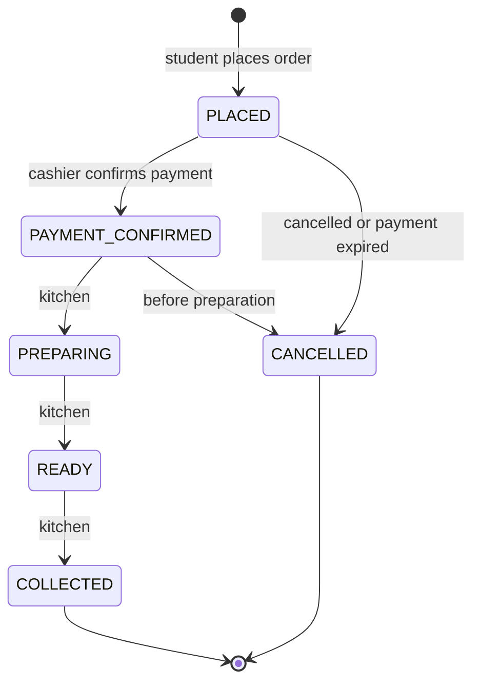
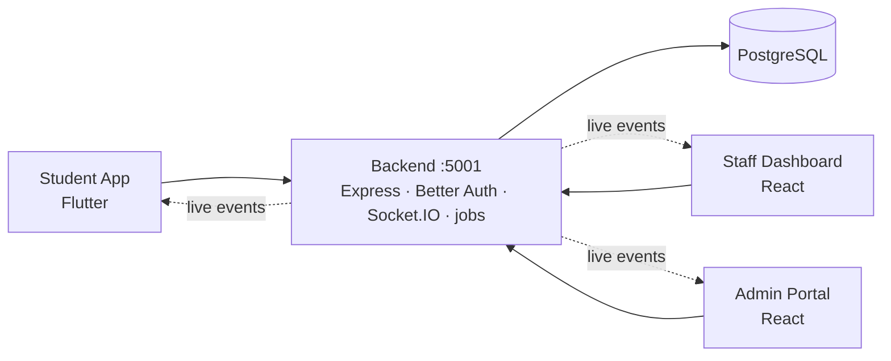

# SERVE — Evaluation Preparation Notes

Study notes for both team members, based on the actual code at `main`
(commit `9d68600`). Every technical statement was checked against the
repository. Paths are relative to the repository root.

**Labels used**

| Label | Meaning |
| --- | --- |
| ✅ Implemented | Works and is covered by automated tests |
| 🟡 Partial | Some of it works; the limitation is stated |
| 🧪 Demo-only | Works, but only in test (DEMO) mode — no real money |
| 🗓️ Planned | Not built |
| ❔ Team must confirm | Cannot be known from the code (research, ownership) |

> **Field research is not in the repository.** There are no interview notes,
> quotes, survey results or measured numbers anywhere in the code or the Git
> history. Every research item in this document is a **template** to fill from
> your own notes. Never present a finding you cannot show.

---

## Contents

- [Part 1 — How SERVE works](#part-1--how-serve-works)
- [Part 2 — Notes by rubric criterion](#part-2--notes-by-rubric-criterion)
  - [A1 Problem clarity](#a1--problem-clarity-15-marks)
  - [A2 Field evidence](#a2--field-evidence-15-marks)
  - [A3 Solution and prototype](#a3--solution-and-prototype-20-marks)
  - [A4 Technical execution](#a4--technical-execution-20-marks)
  - [A5 Presentation and clarity](#a5--presentation-and-clarity-15-marks)
  - [A6 Team ownership](#a6--team-ownership-15-marks)
- [Part 3 — Code walkthrough](#part-3--code-walkthrough)
- [Part 4 — Evaluator question bank](#part-4--evaluator-question-bank)
- [Part 5 — Weaknesses and cross-questions](#part-5--weaknesses-and-cross-questions)
- [Part 6 — Final revision material](#part-6--final-revision-material)
- [Information the team must supply](#information-the-team-must-supply)

---

## Part 1 — How SERVE works

### 1.1 What SERVE is

SERVE is an ordering and kitchen-operations platform for the **hostel canteens
of SRM University-AP**. It has three apps and one backend:

| App | Folder | Users | Technology |
| --- | --- | --- | --- |
| Student App | `apps/student` | Students | Flutter (web, Android, iOS) |
| Staff Dashboard | `apps/staff` | Kitchen staff, cashiers | React + Vite |
| Admin Portal | `apps/admin` | Canteen administrators | React + Vite |
| Backend | `backend` | All apps | Node.js, Express, Socket.IO, Better Auth, Prisma, PostgreSQL |

Each hostel belongs to a **service area** that has one **Night** and one **Day**
canteen. Only one of the two takes orders at a time. The seed data has 5 areas
(10 canteens) and 8 hostels (`backend/src/db/seed.ts`).

### 1.2 The journey of one order

1. **Student signs in** with an `@srmap.edu.in` Google account and, the first
   time, registers a name and hostel. The app picks the hostel's canteen.
2. **Student browses the menu** (`GET /api/canteens/:id/menu`). Unavailable items
   are visible but cannot be ordered.
3. **Cart quote:** the app sends item ids and quantities only; the server
   calculates prices (`POST /api/cart/quote`).
4. **Place order:** `POST /api/orders` with an `Idempotency-Key` header. The
   server creates an `Order` (status `PLACED`), `OrderItem` snapshots and a
   `Payment` (`PENDING`) with a deadline 20 minutes ahead.
5. **Pay:** the student pays the canteen's UPI QR (or a labelled DEMO QR in test
   mode) and taps **I've paid** (`POST /api/payments/:orderId/claim`).
6. **Cashier confirms** from the claim queue
   (`POST /api/staff/orders/:id/confirm-payment`): payment → `SUCCESS`, order →
   `PAYMENT_CONFIRMED`. Only now does the order appear on the kitchen board.
7. **Kitchen** moves it to `PREPARING` → `READY` → `COLLECTED`
   (`PATCH /api/staff/orders/:id/status`).
8. **Every change is pushed live** over Socket.IO to the student, that canteen's
   staff and the admins.
9. If the student never claims payment, a background job **expires** the order
   after the deadline.



(This is exactly the table `ORDER_TRANSITIONS` in
`backend/src/modules/orders/order-state.ts`.)

---

## Part 2 — Notes by rubric criterion

## A1 — Problem clarity (15 marks)

### The problem

At peak hours, students at SRM University-AP's night canteens queue in person to
order and pay, without knowing their wait, whether an item is available, or
when their order is ready. Behind the counter, staff take orders verbally, check
UPI payments by hand, and have no structured way to slow intake when the kitchen
is overloaded.

(The customer part is written in the repository's README, "Problem We Solve".
The staff part is what SERVE's design addresses; confirm it with your interview
notes.)

### Who experiences it

| Group | What they experience |
| --- | --- |
| Hostel students | Queueing, uncertainty about wait, availability and order status |
| Kitchen staff | Bursts of verbal orders; effort on orders that may not be paid |
| Cashiers | Manual UPI checks; disputes about whether money arrived |
| Shift lead | No controlled way to stop new orders when overloaded |
| Administrators | Several Day/Night outlets, staff access, no combined sales record |

### Why the existing process is inefficient, and the root causes

| Symptom | Root cause |
| --- | --- |
| Students wait in line to order and again to collect | The counter is the **only channel** for ordering and information |
| Students don't know if food is available or ready | **No shared, live information** between kitchen and customers |
| Payments are checked one by one | **UPI is outside any system**; nothing links a payment to an order |
| Kitchen gets overloaded | **No intake control**; the queue just grows |
| Managers can't see what sold where | **No records**; everything is verbal |

### Why software is appropriate

The problems are about **information and coordination**, not cooking. Software
can carry orders, statuses and payments between students and staff instantly,
enforce rules (prices, legal status changes, who may do what) and keep records
— none of which a paper or verbal process can do at peak load.

### How SERVE addresses each problem

| Problem | SERVE feature |
| --- | --- |
| Queue to order | Order from the app; pickup only |
| Unknown availability | Live menu availability |
| Unknown order status | Order number + live tracking |
| Manual payment checks | UPI claim queue for cashiers; unpaid orders expire |
| Kitchen overload | **Pause orders** (manual) |
| Unpaid orders waste effort | Kitchen board shows **paid orders only** |
| No records | Admin reports and dashboards |
| Two canteens per area | Day/Night switching with only one open at a time |

**Not solved yet:** students still get **no wait-time estimate** — be honest
about this (Part 5).

### 1-minute explanation (practise aloud)

> "Every evening, students in our hostels depend on the night canteens. At peak
> time the only way to order is the counter: you queue, order, pay, and wait
> again — without knowing how long it will take or whether your food is even
> available. Behind the counter, staff take orders verbally, check UPI payments
> one by one, and when the kitchen is overloaded the queue simply grows. We
> realised fixing only the customer side would move the queue into the kitchen.
> So SERVE connects both sides: students order and pay from an app and watch
> their order live; staff get a paid-orders kitchen board, a payment-confirmation
> queue and a pause button; and administrators manage the canteens and see
> reports — all on one backend."

**Avoid:** "Canteens need an app" — that is a solution, not a problem.
**Numbers:** none have been measured. Say so if asked.

---

## A2 — Field evidence (15 marks)

### What the repository contains

Nothing. No notes, dates, quotes or numbers. Everything below is what **you must
bring** from your own records.

> ⚠️ **Name the role consistently.** In earlier discussions the team described the
> Slice of Life contact as the **manager**; this brief says **owner**. Confirm
> which is correct and use only that.

### Evidence to prepare

| Evidence | What to bring | Source |
| --- | --- | --- |
| Slice of Life conversation | Date, duration, who attended, the interviewee's role, questions asked, actual answers, **one line in their own words** | ❔ Your notes |
| Staff workflow | How orders are taken, tracked and handed over; how payments are checked | ❔ Your notes / observation |
| Operational constraints | Kitchen capacity at peak; what happens when overloaded; peak window | ❔ Your notes |
| Student experience | How long students wait; what frustrates them | ❔ Your notes / informal talks |
| E-Cell interaction | Date, number and roles of people, the actual feedback | ❔ Your notes |
| Requirements gathered | A list of "they need …" statements, each tied to a person | ❔ Your notes |
| Feedback and changes | What someone said → what you changed | ❔ Your notes + Git history |

### Connect each piece of evidence to a product decision

Use this table in the review. Fill the left column **only** with what was
actually said; the right column is what exists in SERVE.

| What we heard (❔ fill from notes) | Problem it shows | Decision in SERVE | Where in code |
| --- | --- | --- | --- |
| … about orders arriving at once at peak | Kitchen overload | **Pause orders** | `PATCH /api/staff/canteen/status` (`backend/src/modules/staff/staff.routes.ts`) |
| … about checking UPI payments | Manual verification | **UPI claim queue**, unpaid-order expiry | `backend/src/modules/staff/cashier.service.ts`, `backend/src/modules/payments/unpaid-order-expiry.ts` |
| … about unpaid or abandoned orders | Wasted kitchen effort | Kitchen sees **paid orders only** | `STAFF_VISIBLE_STATUSES` in `order-state.ts` |
| … about separate day and night operation | Two outlets per area | **Day/Night** service areas and scheduler | `backend/src/modules/admin/area-scheduler.ts` |
| … about students not knowing order status | Uncertainty | **Live tracking** | Socket.IO `order.*` events |
| … about business information (E-Cell) | No insight | Admin **reports**; Market Intelligence as future work | `backend/src/modules/admin/admin-reports.ts` |

**What the Git history can show** (verifiable): management features were added
after the core ordering flow — cashier counter sales and DEMO/LIVE payment
controls (3 Nov 2026), Day/Night service areas and scheduling (16 Nov 2026), and
the UPI claim queue with unpaid-order expiry (25 Nov 2026). If your research
prompted these, say which conversation led to which change.

### Rubric preparation (from the evaluation reference)

- Keep interview notes with the **date** and **role** of each person.
- Write down **one line each person actually said**, in their own words.
- Bring the notes, printed or on a laptop.
- Report findings honestly, including any that went **against** your original idea.

**Market Intelligence** (E-Cell direction) is **not implemented**. Present it as
future scope, not as a feature.

---

## A3 — Solution and prototype (20 marks)

### Feature status

**Student App** (`apps/student`)

| Feature | Status |
| --- | --- |
| SRM Google sign-in; registration with hostel | ✅ |
| Home with recommendations | ✅ |
| Menu: search, filters, live availability, Day/Night prices | ✅ |
| Cart (one canteen) with server-priced quote; pickup-only checkout | ✅ |
| UPI payment with "I've paid" and UPI reference | ✅ (🧪 DEMO QR in test mode) |
| Order number and live tracking; history; cancel before preparation | ✅ |
| In-app notifications | ✅ |
| Favourites, recently viewed | 🟡 Stored on the device only |
| Google sign-in on a physical phone | 🟡 Needs the backend on a public https URL |
| Push notifications, wait-time estimate | 🗓️ |

**Staff Dashboard** (`apps/staff`)

| Feature | Status |
| --- | --- |
| Email + password sign-in; self-registration → PENDING → approval | ✅ |
| Dashboard counters; **Pause / Resume orders** | ✅ (manual only) |
| Kitchen board (paid orders): New → Preparing → Ready → Collected | ✅ |
| Menu management | ✅ |
| Cashier: claim queue, counter sales (cash/UPI), receipts | ✅ (🧪 DEMO payments simulated) |
| Password change | ✅ |
| Automatic capacity-based pausing | 🗓️ |

**Admin Portal** (`apps/admin`)

| Feature | Status |
| --- | --- |
| Email + password sign-in (created only by `admin:create`) | ✅ |
| Dashboard; staff approval, canteen assignment, capabilities, deactivation | ✅ |
| Canteens, Day/Night service areas, automatic schedule, overrides, pause | ✅ |
| Payment mode DEMO/LIVE and UPI QR upload | ✅ |
| Menu catalogue and pricing; reports (daily) | ✅ |
| Activity history | 🟡 Server logs only; the page explains there is no stored history |
| Razorpay online payments | 🟡 Signature verification only; API calls pending |
| Forecasting, Market Intelligence | 🗓️ |

### How the dashboards communicate

They never talk to each other directly. Each app talks only to the backend:
REST calls to change things, and Socket.IO events to hear about changes. Example:
when a cashier confirms a payment, the backend saves it and then sends
`order.payment_confirmed` to the student's room and to the canteen room — the
kitchen board and the student's tracking screen update by themselves.

### Live demo script

**Before the demo**

- Backend, staff, admin and student apps running (README section 8).
- Database migrated and seeded; an admin created with `admin:create`.
- **A real Google OAuth client** configured for student sign-in (otherwise skip
  step 4 and explain it with the automated test).
- The demo canteen in **DEMO** payment mode.
- **Three separate browser profiles** (student, staff, admin) — all apps share one
  sign-in cookie on `localhost`, so one browser cannot hold three roles.

| # | Who | Action | Say |
| --- | --- | --- | --- |
| 1 | Admin | Sign in with email + password | "Admins are created only by a script; there is no public admin sign-up." |
| 2 | Staff | **Request access**: name, personal email, password, canteen | "Staff can use any email. The account stays pending." |
| 3 | Staff | See **Awaiting approval**; try `/orders` | "Unapproved staff cannot reach the kitchen — the backend returns 403." |
| 4 | Admin | **Change requests → Approve**; **Staff → tick CASHIER → Save permissions** | "Permissions are per canteen; approval gives Kitchen, Menu and Pause; Cashier is granted separately." |
| 5 | Student | Sign in with SRM Google; register name + hostel | "Only verified @srmap.edu.in accounts." |
| 6 | Student | Menu → cart → place order | "The phone sends only item ids; the server sets the prices." |
| 7 | Student | Pay screen (DEMO QR) → **I've paid** | "This QR is clearly labelled test-only; no money moves." |
| 8 | Staff | **Cashier** → claim queue → confirm | "Now the order reaches the kitchen — unpaid orders never do." |
| 9 | Staff | **Orders** → Preparing → Ready | Point at the student screen updating live |
| 10 | Staff | **Pause orders**; student tries to order | "New orders are refused, existing ones continue." Then **Resume** |
| 11 | Staff | **Collected** | Order complete |
| 12 | Admin | **Reports** | "Sales by canteen, Day/Night, channel and payment method." |

**Do not demonstrate or claim:** card/online payments, push notifications, wait
times, automatic pausing, forecasting, Market Intelligence, a public deployment.

---

## A4 — Technical execution (20 marks)

Each topic: **what** it is · **why** · **how SERVE uses it** · **where** ·
**example** · likely **question** and **answer**.

### 1. Overall architecture

- **What:** three client apps + one backend + one PostgreSQL database.
- **Why:** one source of truth for prices, roles and order status; no app can
  disagree with another.
- **How/where:** `backend/src/server.ts` starts Express (`createApp` in
  `backend/src/app.ts`), Socket.IO (`backend/src/realtime/socket-server.ts`) and
  two background jobs (Day/Night scheduler every 30 s, unpaid-order expiry every
  60 s).



- **Q:** Why not let the staff app write to the database directly?
  **A:** Then every client would need database credentials and would have to
  enforce the rules itself. The backend is the single gatekeeper: it checks who
  you are, what you may do and whether the change is legal.

### 2. Technology choices

| Technology | Why (stated or evident in the repo) |
| --- | --- |
| Flutter | One codebase for Android, iOS and web for students |
| React + Vite | Fast, component-based desktop dashboards |
| Node.js + Express + TypeScript | One language (TypeScript) across backend and web apps; shared types |
| PostgreSQL | Relational data with real constraints (unique indexes, CHECKs, triggers) |
| Prisma | Type-safe database access and versioned migrations |
| Socket.IO | Push updates to browsers and the mobile app with rooms and reconnects |
| Better Auth | Google OAuth and email + password with database sessions, without building auth from scratch |
| Zod | One schema language for validating requests and describing API responses |

- **Q:** Why not Firebase?
  **A:** The project started with Firebase Authentication and replaced it with
  Better Auth (commit `567db0e`), so sessions and identities live in our own
  PostgreSQL database next to the role data.

### 3. Flutter application architecture

- **What:** screens + controllers (state) + services (API, auth, realtime).
- **How:** `lib/main.dart` builds the config, `AuthController`, `ServeApi`
  (wrapping `ApiClient`) and `SocketRealtimeService`; `lib/app.dart` provides them
  with `provider` and `AuthGate` routes purely on `GET /api/auth/me`.
- **Where:** `lib/services/` (api, auth, realtime), `lib/state/`
  (`CartController`, `CanteenSelection`, `NotificationsController`), `lib/ui/screens/`.
- **Example:** `order_tracking_screen.dart` loads the order, then listens for
  realtime events whose type starts with `order.` for that order id and replaces
  the order on screen.
- **Q:** How does the app know it is signed in?
  **A:** On web the backend sets an HttpOnly cookie the app cannot read; the app
  calls `/api/auth/me`. On Android/iOS it gets a session token through a PKCE
  hand-off and stores it in secure storage (`flutter_secure_storage`).

### 4. React dashboard architecture

- **What:** two React apps sharing `packages/web-shared`.
- **How:** `AuthProvider` (`packages/web-shared/src/auth.tsx`) holds the session
  and the account from `/api/auth/me`; `ApiClient` (`api.ts`) sends requests with
  the cookie; `RealtimeProvider` (`realtime.tsx`) keeps one socket; pages
  subscribe with `useServerEvent`.
- **Example:** `apps/staff/src/pages/OrdersPage.tsx` uses
  `useServerEvent('order.payment_confirmed', …)` to add new paid orders to the
  board, and `useServerEvents(['order.preparing','order.ready',…])` to move them.
- **Q:** What decides what a staff member sees?
  **A:** Only the backend. The `Gate` in `apps/staff/src/App.tsx` routes on
  `/api/auth/me`: pending → access status page, approved → dashboard. Nav items
  hide by capability, and the backend refuses the API calls anyway.

### 5. Node.js and Express backend

- **What:** Express 5 app split into modules (`backend/src/modules/*`): auth,
  canteens, menu, orders, payments, staff, admin, students, notifications,
  change-requests, health.
- **How:** each module has a router (input validation, guards) and a service
  (business rules, database transactions). Request pipeline in `app.ts`: logger →
  helmet → CORS → rate limit → Better Auth routes → JSON parser → CSRF origin check
  → module routers → error handler.
- **Q:** Where is the business logic?
  **A:** In services, not routers. For example `updateStatusByStaff` in
  `backend/src/modules/orders/orders.service.ts` checks the transition, updates
  the row, writes a notification and queues the realtime event.

### 6. REST API communication

- **What:** JSON over HTTP under `/api`; 103 SERVE endpoints plus Better Auth's.
- **Example:** `POST /api/orders` returns `201` with `{ "data": order }`, or `200`
  with header `Idempotent-Replayed: true` if the same request is repeated.
- **Errors:** always `{ "error": { "code", "message", "details?", "requestId?" } }`.
- **Q:** What happens if the student taps "Place order" twice?
  **A:** Both requests carry the same `Idempotency-Key`. The database has a unique
  index on `(studentId, idempotencyKey)`; the second request returns the first
  order. Reusing the key with a different cart is refused — the server compares a
  SHA-256 hash of the request.

### 7. PostgreSQL database

- **What:** relational database; 26 models (tables), 13 enums, 11 migrations.
- **Why:** orders, payments and staff permissions need constraints the database
  itself guarantees.
- **Example constraint:** a partial unique index
  `Canteen_one_open_per_service_area` allows at most one canteen per area with
  `isActive AND isAcceptingOrders` — Day/Night exclusivity cannot be broken even by
  a bug in the code.
- **Q:** Why store money as integers?
  **A:** Prices are integer **paise** (₹1 = 100) to avoid floating-point rounding
  errors.

### 8. Prisma ORM and schema

- **What:** schema in `backend/prisma/schema.prisma`; generated client used as
  `prisma.order.findMany(...)`; migrations in `backend/prisma/migrations/`.
- **Commands:** `npm run prisma:generate --workspace backend`,
  `npm run prisma:migrate:deploy --workspace backend`.
- **Example (transaction):**

```ts
let updated = await prisma.$transaction(async (tx) => {
  const changed = await tx.order.updateMany({
    where: { id: order.id, canteenId, status: order.status },
    data: { status: target /* + timestamp */ },
  });
  if (changed.count === 0) throw new ConflictError('The order changed. Refresh and try again.', 'ORDER_STATE_CHANGED');
  // … notification + queueOrderEvent(outbox, fresh, order.status)
});
outbox.flush(events);
```

- **Q:** Why `updateMany` with the old status in `where`?
  **A:** It is a conditional update. If two staff press buttons at once, only one
  matches the old status; the other gets `ORDER_STATE_CHANGED` instead of
  overwriting.

### 9. Relationships and constraints

| Relationship / rule | Where |
| --- | --- |
| ServiceArea → Canteens (Day + Night), Hostels | `ServiceArea`, `Canteen`, `Hostel` |
| Canteen → MenuCategory → MenuItem → MenuItemService (price per period) | menu models |
| Student → Order → OrderItem (immutable snapshot) + one Payment | `Order`, `OrderItem`, `Payment` |
| Staff → one StaffCanteenAssignment → capabilities | `StaffAssignmentCapability` |
| One approved staff account per canteen | partial unique `Staff_one_approved_account_per_canteen` |
| OrderItem rows cannot be updated | trigger, migration `20261006090000_order_item_integrity` |
| An expired payment must be FAILED | CHECK `Payment_expired_is_failed_check` |
| One sign-in identity ↔ one role account | trigger `AuthUser_single_role_account` |

### 10. Authentication and authorization

- **Authentication** (who you are): Better Auth (`backend/src/lib/auth.ts`).
- **Authorization** (what you may do): roles from PostgreSQL, loaded on every
  request by `createAuthenticate` → `principalForSession`
  (`backend/src/middleware/auth.ts`), then guards: `requireStudent`,
  `requireApprovedStaff`, `requireAdmin`, `requireStaffCapability`.
- **Q:** Can a student call a staff API by guessing the URL?
  **A:** No. The guard checks the role from the database and answers 403;
  `backend/tests/integration/security.test.ts` sweeps every protected route.

### 11. Student Google authentication

- **How:** `POST /api/auth/sign-in/social` → Google → `GET /api/auth/callback/google`.
  Better Auth's `validateUserInfo` and session hook accept only
  `email_verified` addresses ending exactly in `@srmap.edu.in`
  (`backend/src/modules/auth/srm-email.ts`). Then `POST /api/auth/student/register`
  (name + hostel).
- **Q:** Could `x@srmap.edu.in.evil.com` sign in?
  **A:** No — the check is an exact domain match; that case is in the unit tests
  (`backend/tests/unit/srm-email.test.ts`).

### 12. Staff and admin authentication

- **Staff:** `POST /api/auth/staff/sign-up` (name, any email, password, canteen) →
  `Staff` row **PENDING**; then `POST /api/auth/sign-in/email`. Passwords:
  10–128 characters, hashed with **scrypt** by Better Auth.
- **Admins:** created only by `npm run admin:create --workspace backend`; no
  public sign-up. Password change: `POST /api/auth/change-password`.
- **Rule enforced on every request and socket:** the session records how it was
  created (`AuthSession.authMethod` = `google` or `password`); students must be
  Google, staff and admins must be password (`isSignInMethodAllowed` in
  `backend/src/modules/auth/sign-in-method.ts`). A mismatching session is
  deleted.
- **Q:** What stops a staff member signing in with Google?
  **A:** The session-creation hook in `lib/auth.ts` refuses Google for any staff or
  admin address (`STAFF_ADMIN_USE_PASSWORD`), and even an old Google session is
  refused on use.

### 13. Role-based access control

| Role | Guard | Extra checks |
| --- | --- | --- |
| Student | `requireStudent` | Own orders only (others answer 404) |
| Staff | `requireApprovedStaff` + `resolveStaffCanteen` | Only their own canteen; capability per action: `KITCHEN`, `MENU`, `PAUSE`, `CASHIER` |
| Admin | `requireAdmin` | Account must be active |

- **Example:** `router.patch('/canteen/status', pause, …)` in
  `backend/src/modules/staff/staff.routes.ts`, where
  `pause = requireStaffCapability(ctx.prisma, 'PAUSE')`.

### 14. Socket.IO and realtime

- **How:** clients connect with their session; the server verifies it and puts
  them in rooms it chooses (`roomsFor` in `socket-server.ts`):
  `student:<id>`, `staff:<id>`, `canteen:<id>`, `admin`.
- **Outbox pattern:** services collect events during a transaction and publish
  them only after it commits (`backend/src/realtime/events.ts`), so nobody sees a
  change that was rolled back.
- **Example (`queueOrderEvent`, `backend/src/modules/orders/order.events.ts`):**

```ts
if (order.studentId) outbox.emit(name, [rooms.student(order.studentId)], { order: …, previousStatus });
// Walk-in POS bills must not appear on the app kitchen board.
if (order.paidAt !== null && order.channel === 'APP')
  outbox.emit(name, [rooms.canteen(order.canteenId)], { order: …, previousStatus });
outbox.emit(name, [rooms.admins()], { order: …, previousStatus });
```

- **Q:** Can a student listen to another canteen's orders?
  **A:** No. Clients cannot choose rooms; the only room a client can request is
  the read-only public menu room of a canteen it may see. Tested in
  `realtime.test.ts` and `e2e/tests/realtime-isolation.spec.ts`.

### 15. Zod validation

- **Where:** `backend/src/http/validation.ts` (`parse`, `id`, `email`, `pricePaise`…)
  and per-route schemas; shared response schemas in `packages/contracts/src/index.ts`.
- **Example:** staff sign-up body is a `z.strictObject` — sending
  `status: 'APPROVED'` is rejected with 422, so nobody can approve themselves.
- **Q:** Why `strictObject`?
  **A:** Unknown fields are errors, not silently ignored — it blocks attempts to
  set fields the client must not control.

### 16. Error handling

- **How:** throw `AppError` subclasses (`ValidationError`, `ForbiddenError`,
  `ConflictError`… in `backend/src/lib/errors.ts`); the central handler
  (`backend/src/middleware/error-handler.ts`) turns them (and Zod errors) into the
  JSON envelope with a `requestId`. Clients map codes to friendly messages.
- **Q:** What does a student see if the canteen is paused?
  **A:** The server answers `CANTEEN_NOT_ACCEPTING_ORDERS`; the app shows "This
  canteen is currently not accepting orders."

### 17. Security considerations

- Server-side prices, totals and roles; clients never send them.
- HttpOnly `SameSite=Lax` session cookie; `Secure` in production.
- helmet headers, exact-origin CORS list, CSRF origin check for cookie writes.
- Global and per-user rate limits; stricter on sign-in, sign-up, orders, payments.
- Passwords hashed with scrypt; logs redact passwords, tokens, cookies, UPI IDs.
- Startup validation (`backend/src/config/env.ts`): production refuses localhost
  URLs, local databases, missing Google credentials, and the mock payment
  provider unless `DEMO_MODE=true`.

### 18. Testing and code quality

| Suite | Tool | Result on `9d68600` |
| --- | --- | --- |
| Backend unit + integration (real PostgreSQL, real Better Auth) | Vitest + supertest | 613 passed |
| Shared web / staff / admin | Vitest + Testing Library | 68 / 57 / 63 passed |
| Student app | flutter_test | 197 passed, 1 opt-in skipped |
| End-to-end (real backend + browsers) | Playwright | 39 passed, 1 opt-in skipped |

Plus `npm run typecheck`, `npm run lint` (ESLint), `npm run format:check`
(Prettier) — all passing. Key tests: `critical-flow.test.ts`,
`upi-claim-queue.test.ts`, `role-sign-in.test.ts`, `security.test.ts`,
e2e `critical-flow.spec.ts`, `payment-queue.spec.ts`, `operations.spec.ts`.

- **Q:** Is Google mocked in tests?
  **A:** Only Google's token endpoint is replaced; Better Auth's real flow runs
  (`google-oauth.test.ts`). Other tests use a sign-in endpoint that exists only
  when `NODE_ENV=test`.

### 19. Environment and configuration

- Only `backend/src/config/env.ts` reads `process.env`, validating every variable
  with Zod. Key variables: `DATABASE_URL`, `BETTER_AUTH_URL`, `BETTER_AUTH_SECRET`,
  `GOOGLE_CLIENT_ID/SECRET`, `CORS_ORIGINS`, `PAYMENT_MODE`, `PAYMENT_SECRET`,
  `UNPAID_ORDER_EXPIRY_MINUTES`. Web apps need only `VITE_API_URL`.
- **Q:** What happens if a secret is missing?
  **A:** The server refuses to start and prints the variable's name, never its
  value.

### 20. Deployment

- **Status:** 🟡 **prepared, not deployed.** One Node process can serve all three
  web apps plus the API on one domain (`WEB_ROOT`, `npm run build:web`);
  `Dockerfile` and `deploy/Caddyfile`, `deploy/nginx.conf` exist.
- **Q:** Is it live?
  **A:** No. It runs locally; deployment configs are ready but not used yet.

---

## A5 — Presentation and clarity (15 marks)

### Introduction (20 seconds)

> "SERVE is an ordering and kitchen-operations platform for our hostel canteens.
> Students order and pay from an app and track their food live; canteen staff
> confirm payments, run a kitchen board and can pause orders when overloaded;
> administrators manage the canteens and staff. Three apps, one backend."

### 2-minute explanation

1. **Problem (30 s):** the 1-minute A1 story, shortened.
2. **Evidence (20 s):** who you spoke to and the one line that mattered (❔ from notes).
3. **Solution (40 s):** the order journey — order → I've paid → cashier → kitchen → live → collect; plus Pause.
4. **Engineering (20 s):** one backend as the source of truth; prices and roles on the server; realtime after commit; 600+ backend tests.
5. **Limits and next steps (10 s):** no wait-time estimate or automatic pause yet; Razorpay and deployment next.

### Presentation flow and transitions

| From → to | Transition line |
| --- | --- |
| Problem → evidence | "We didn't want to assume this, so we spoke to …" |
| Evidence → solution | "That told us the kitchen side matters as much as the student side, so …" |
| Solution → demo | "Let me show one order going through all three apps." |
| Demo → architecture | "Here is what made that update appear instantly." |
| Architecture → limits | "Here is what we have not built yet, and why." |

### Explaining diagrams

Start from the **user**, then follow the arrow: "the student app sends the order
to the backend, the backend saves it in PostgreSQL, then pushes an event to the
kitchen." Never start with technology names.

### Numbers without exaggeration

| Say | Don't say |
| --- | --- |
| "613 backend tests pass" | "fully tested and production-ready" |
| "10 canteens in our seed data" | "used by 10 canteens" |
| "Not measured yet" | any invented wait-time or adoption figure |

### Answering questions

1. Answer in one sentence first, then give the detail.
2. Point to the file or the demo if possible.
3. If it isn't built, say "not implemented yet" and say what you'd do.
4. If you don't know, say so and offer how you would find out.

---

## A6 — Team ownership (15 marks)

### Modules, files and dependencies

| Module | Main files | Depends on |
| --- | --- | --- |
| Student App | `apps/student/lib/` | Backend REST + Socket.IO; Better Auth (Google) |
| Staff Dashboard | `apps/staff/src/` | `packages/web-shared`, backend |
| Admin Portal | `apps/admin/src/` | `packages/web-shared`, backend |
| Shared web code | `packages/web-shared/src/` (auth, api, realtime, UI) | `packages/contracts` |
| API contract | `packages/contracts/src/index.ts` | — |
| Auth | `backend/src/lib/auth.ts`, `lib/session.ts`, `middleware/auth.ts`, `modules/auth/` | Database |
| Orders and pricing | `backend/src/modules/orders/` | Canteens, payments, realtime |
| Payments and claim queue | `backend/src/modules/payments/`, `modules/staff/cashier.service.ts` | Orders, realtime |
| Canteens, Day/Night | `backend/src/modules/canteens/`, `modules/admin/area-scheduler.ts` | Database |
| Staff and admin APIs | `backend/src/modules/staff/`, `modules/admin/` | Everything above |
| Realtime | `backend/src/realtime/` | Auth (sockets) |
| Database | `backend/prisma/schema.prisma`, `migrations/`, `src/db/seed.ts` | — |
| Tests | `backend/tests/`, `apps/*/tests`, `apps/student/test/`, `e2e/` | All |

### What the Git history shows (not proof of ownership)

| Git author | Commits on `main` | Areas their own commits touched |
| --- | --- | --- |
| Claude (AI-assisted) | 46 | Most of the initial backend, apps, auth, docs |
| Pranathi Balusu | 12 (incl. 5 merges) | Admin portal, UPI claim queue, payments, e2e, auth fixes |
| krutthiikaaa | 7 | Student app redesign, day/night menus, cashier POS, DEMO/LIVE payments |
| kruthika | 12 (mostly merges) | README |

❔ Confirm: who owns what; whether "kruthika" and "krutthiikaaa" are the same
person; who directed the AI-assisted commits. **Do not present line counts or
percentages as contribution.**

### What each member must understand about the other's work

Both members must be able to explain, without notes:

- the order journey (Part 1.2) and the state machine;
- the UPI claim queue and why a claim is not proof of payment;
- Pause: what it does and what it doesn't do;
- role-specific sign-in and how the backend enforces it;
- Day/Night exclusivity and the scheduler;
- how realtime updates reach the right screens;
- how to run the app and the tests.

### Cross-questioning scenarios

| Evaluator asks member A about member B's area | A good answer covers |
| --- | --- |
| "Your partner built the student app — how does it get live updates?" | `SocketRealtimeService`, events filtered by order id in the tracking screen, refetch on reconnect |
| "How does the cashier queue avoid double confirmation?" | Conditional `updateMany` on the Payment row; only one decision wins |
| "Where are prices calculated?" | `backend/src/modules/orders/pricing.ts`; client sends ids only |
| "What happens when an admin approves staff?" | Canteen assigned, KITCHEN/MENU/PAUSE granted, `staff.approved` event, dashboard unlocks |
| "Why can't staff switch canteens?" | One assignment per staff; `resolveStaffCanteen` refuses other canteen ids |
| "Explain your partner's database migration" | e.g. `20261121090000_upi_claim_queue`: `claimedAt`, `paymentDueAt`, `expiredAt`, CHECK constraint |

---

## Part 3 — Code walkthrough

### Module guide

| Module | Purpose | Data in | Data out | Key functions |
| --- | --- | --- | --- | --- |
| `modules/auth` | Identity and accounts | Sign-in requests, registration bodies | Sessions, `Me` | `createAuth`, `principalForSession`, `signUpStaff`, `registerStudent` |
| `modules/orders` | Quotes, orders, status | Cart lines, Idempotency-Key, staff status | `StudentOrder`/`StaffOrder` DTOs, events | `pricing.ts`, `create`, `updateStatusByStaff`, `queueOrderEvent` |
| `modules/payments` | Claims, verification, expiry | Claims (UTR), webhooks | Payment state, `payment.queue_changed` | `claim`, `createUnpaidOrderExpiry` |
| `modules/staff` | Kitchen, menu, cashier, pause | Staff actions | Dashboard, board, receipts | `setAcceptingOrders`, `cashier.service.ts` |
| `modules/canteens` | Canteens, menus, availability | Canteen ids | Menu, availability state | `evaluateServiceAvailability`, `applyStaffPause` |
| `modules/admin` | Management | Admin actions | Reports, dashboards | `adminReports`, `createAreaScheduler` |
| `realtime` | Push updates | Committed events | Socket.IO messages | `Outbox`, `roomsFor`, `createRealtimeServer` |
| `apps/student` | Customer UI | User input, events | API calls | `ServeApi`, `AuthController`, `CartController` |
| `apps/staff`, `apps/admin` | Operations UI | User input, events | API calls | `AuthProvider`, `useServerEvent`, `staffApi`, `adminApi` |

### Complete order lifecycle through the code

| # | Step | Code |
| --- | --- | --- |
| 1 | Student taps **Place order** | Flutter `ServeApi.placeOrder(canteenId, items, idempotencyKey: …)` (`apps/student/lib/services/api/serve_api.dart`) |
| 2 | API request | `POST /api/orders` with `Idempotency-Key`; route in `backend/src/modules/orders/orders.routes.ts` — guarded by `createAuthenticate` + `requireStudent`, rate-limited, body parsed with Zod |
| 3 | Backend processing | `services.orders.create(currentStudent(req), key, body)`: prices the cart server-side (`pricing.ts`), checks the canteen is open (`evaluateServiceAvailability`), handles key replay |
| 4 | Database update | One transaction: `Order` (PLACED, `SV…` number from a sequence), `OrderItem` snapshots, `Payment` (PENDING, `paymentDueAt = now + 20 min`), `ORDER_PLACED` notification |
| 5 | Payment claim | `POST /api/payments/:orderId/claim` → `claimedAt` set; `payment.queue_changed` to the canteen's cashiers |
| 6 | Cashier confirms | `POST /api/staff/orders/:id/confirm-payment` → `cashier.service.ts`: Payment `SUCCESS` (`verifiedByStaffId`), Order `PAYMENT_CONFIRMED`, receipt number |
| 7 | Realtime event | `queueOrderEvent` emits `order.payment_confirmed` to `student:<id>`, `canteen:<id>` and `admin`, after commit (`outbox.flush`) |
| 8 | Staff dashboard | `OrdersPage.tsx` `useServerEvent('order.payment_confirmed')` adds the card to **New** |
| 9 | Status update | Staff clicks **Preparing** → `PATCH /api/staff/orders/:id/status` (guard `KITCHEN`) → `updateStatusByStaff`: `assertTransition`, conditional `updateMany`, `preparingAt` timestamp, notification, `queueOrderEvent` |
| 10 | Student receives it | `order_tracking_screen.dart` receives `order.preparing` for its order id and redraws the timeline |
| 11 | Ready, collected | Same path with `order.ready`, `order.collected` |

---

## Part 4 — Evaluator question bank

### Problem and requirements

1. **What problem does SERVE solve?** Peak-hour canteen queues with no visibility for students, and manual orders, payments and no intake control for staff.
2. **Who is the user?** Hostel students; canteen kitchen staff and cashiers; canteen administrators.
3. **Isn't this just a food-ordering app?** No — most of the work is on the kitchen side: paid-only board, payment claim queue, pause, Day/Night, permissions.
4. **What are the requirements you implemented first?** Ordering, live status and server-side pricing; then staff approval, cashier tools, Day/Night and the claim queue (Git history).
5. **What is out of scope?** Delivery and cash-on-delivery — SERVE is pickup only.
6. **How do you know the problem is real?** From our field research (❔ cite your notes). Numbers have not been measured.

### Field research

7. **Who did you talk to?** ❔ The Slice of Life manager/owner, and the university E-Cell. Give dates and roles.
8. **What did they say that changed your design?** ❔ One specific line from notes, and the feature it led to.
9. **What surprised you?** ❔ From notes.
10. **Did you talk to students?** ❔ Only if you did; otherwise say not formally.
11. **Why no survey numbers?** Be honest: not collected yet; next step after deployment.

### Solution and features

12. **What happens if a student does not pay?** The order expires after the payment window (default 20 min) and is cancelled; the kitchen never sees it.
13. **Why does a human confirm UPI payments?** UPI transfers happen outside SERVE; a student's "I've paid" and reference are not proof. The cashier checks the credit.
14. **What does Pause do exactly?** Blocks new quotes and orders for that canteen; shows "Paused" to students; existing orders continue.
15. **Is Pause automatic?** No, manual. Automatic capacity-based pausing is future work.
16. **Why Day and Night canteens?** Each area has two outlets that serve at different times; the database lets only one take orders at a time.
17. **Can students order from another hostel's canteen?** Yes, any active canteen that is taking orders; the default is their hostel's.
18. **What is DEMO mode?** Per-canteen test payment mode: a labelled placeholder QR and simulated confirmation; it never counts as real revenue.
19. **Do you support online card payments?** Not yet; the Razorpay adapter has signature verification but no API calls.

### Architecture and technology stack

20. **Why one backend for three apps?** One source of truth for prices, roles and status.
21. **Why Flutter for students but React for staff?** Students need mobile (and web); staff and admins use desktop dashboards. Staff and admin share TypeScript code with the backend.
22. **Why TypeScript?** Shared types between backend and web apps; the zod contract checks response shapes.
23. **Why Better Auth over Firebase?** Sessions and identities in our own PostgreSQL; the project migrated from Firebase.
24. **What is in `packages/contracts`?** Zod schemas for API responses and events, shared by backend tests and web apps.

### Backend and APIs

25. **How is a route protected?** `createAuthenticate` → role guard → canteen resolution → capability guard.
26. **What is idempotency here?** Same `Idempotency-Key` returns the same order; different body with the same key is refused.
27. **How do you prevent price tampering?** The client sends only item ids and quantities; prices come from `MenuItemService` on the server.
28. **What if two staff update the same order?** Conditional update on the old status; the loser gets `ORDER_STATE_CHANGED`.
29. **What background jobs exist?** Day/Night scheduler (30 s) and unpaid-order expiry (60 s), started in `server.ts`.

### Database and Prisma

30. **Main tables?** ServiceArea, Canteen, Hostel, Student, Staff, Admin, MenuCategory, MenuItem, MenuItemService, Order, OrderItem, Payment, Notification, plus Better Auth tables.
31. **Why snapshot order items?** So an order keeps the price and name the student saw; a trigger blocks updates.
32. **How is "only one canteen open per area" enforced?** A partial unique index on `serviceAreaId` where `isActive AND isAcceptingOrders`.
33. **How do migrations work?** Versioned SQL in `backend/prisma/migrations/`, applied with `prisma migrate deploy`.
34. **Why paise?** Integer money avoids rounding errors.

### Authentication and security

35. **Why do staff use passwords but students use Google?** Students are verified SRM accounts; canteen staff may not have SRM Google accounts.
36. **How are passwords stored?** scrypt hashes (Better Auth); never in plain text or logs.
37. **Can anyone register as admin?** No; only `admin:create`.
38. **Can a staff member approve themselves?** No; the sign-up body rejects extra fields, and approval is an admin API.
39. **Are staff emails verified?** No — SERVE sends no email; admin approval is the safeguard. Honest limitation.
40. **How long do sessions last?** 7 days, renewed daily while in use; sign-out deletes the session.
41. **What stops CSRF?** SameSite cookie plus an origin check for cookie-authenticated writes.

### Realtime communication

42. **How does the student see "Ready" instantly?** The backend emits `order.ready` to `student:<id>` after the update commits.
43. **What if the socket disconnects?** Apps refetch on reconnect; the REST API is always the source of truth.
44. **Could events show data that was rolled back?** No; the outbox publishes after commit.

### Testing and deployment

45. **How do you test?** 613 backend tests against a real PostgreSQL test database, web and Flutter tests, and 39 Playwright end-to-end tests.
46. **What is the most important test?** The critical flow: staff onboarding → admin approval → paid order → live kitchen → pickup.
47. **Is it deployed?** No; prepared with Docker and proxy configs.

### Business impact and scalability

48. **What is the impact?** Not measured yet. Expected: less counter queueing and fewer payment disputes — must be measured after deployment.
49. **Will it scale?** One backend instance today; Socket.IO across several instances needs a Redis adapter (planned).
50. **Could it work for a restaurant like Slice of Life?** The model (outlets, menus, staff capabilities, payment queue) is general, but sign-in is tied to SRM accounts for students today.

### Team contribution and ownership

51. **Who built what?** ❔ From your confirmed ownership list — never guess.
52. **Explain your partner's module.** Use Part 3 for any module.
53. **How much was AI-assisted?** Be honest: 46 of 77 commits are authored as Claude; explain how you reviewed and understood them.

**Difficult follow-ups**

- "Your README problem says students don't know the wait — where is the wait estimate?" → Not built; we show stages, not times; next priority.
- "If Pause is manual, how is this better than a sign on the counter?" → Students learn before they walk over, orders are refused server-side, and existing orders continue.
- "Why should a cashier still check payments manually?" → Because UPI is external; a gateway (Razorpay) would remove this.

---

## Part 5 — Weaknesses and cross-questions

| Issue | Why it's asked | Honest answer | Realistic improvement |
| --- | --- | --- | --- |
| No field data or numbers | A2 needs evidence | "We haven't measured wait times yet." | Measure peak wait and orders/night after deployment |
| No wait-time estimate | It's our own stated problem | "We show stages live, not a time." | Estimate from `paidAt`→`readyAt` history |
| Pause is manual | Sounds like a toggle | "It relies on staff noticing overload." | Auto-pause at a staff-set active-order limit |
| UPI confirmed by hand | Manual work remains | "UPI is outside our system." | Razorpay integration |
| No refund record for UPI-confirmed orders | Money trail | "Cancelling a cashier-confirmed order doesn't record a refund." | Add a manual refund record |
| Staff emails unverified | Account squatting | "Admin approval is the safeguard." | Email verification once an email service exists |
| Not deployed | "Does it run anywhere?" | "Locally only; configs ready." | Deploy with Docker + HTTPS |
| One session per browser | Demo failure | "All apps share one cookie on localhost." | Separate browser profiles; per-app cookies later |
| Google needed for student demo | Demo failure | "Student sign-in needs a configured Google client." | Configure it before the demo |
| CASHIER not granted by default | Demo failure | "Approval gives Kitchen, Menu, Pause." | Grant CASHIER in Admin → Staff before the demo |
| Reports are daily only | "Where is peak analysis?" | "No hourly view yet." | Hourly report from `createdAt` |
| No stock levels | Availability is manual | "Staff toggle availability." | Quantity tracking |
| Activity history only in logs | Accountability | "No stored audit table." | Persist audit events |
| No push notifications | App must stay open | "In-app only." | FCM/APNs |
| Single backend instance | Scalability | "One process today." | Socket.IO Redis adapter |
| Much AI-assisted code | Ownership | "We reviewed and can explain each part." | Walk through Part 3 together |
| Older docs mention Firebase | Inconsistency | "Auth docs are authoritative." | Update the old pages |
| No LICENSE file | Reuse questions | "Not licensed yet." | Add a license |

**Demo failure points to rehearse:** backend not running (apps show "Unable to
reach SERVE"); database not seeded (empty canteen list); wrong browser profile
(session replaced); missing CASHIER; Google not configured; canteen in schedule
"off duty" (switch it on in Admin → Canteens).

---

## Part 6 — Final revision material

### 1. One-page revision sheet

- **What:** ordering + kitchen operations for SRM AP hostel canteens; 3 apps, 1 backend.
- **Problem:** peak queues, no visibility (students); manual orders and payments, no intake control (staff).
- **Order path:** PLACED → (I've paid → cashier) → PAYMENT_CONFIRMED → PREPARING → READY → COLLECTED; unpaid orders expire.
- **Key features:** live menu and tracking, UPI claim queue, paid-only kitchen board, Pause, Day/Night, staff approval and capabilities, reports.
- **Sign-in:** students Google (`@srmap.edu.in`); staff and admins email + password; enforced per request.
- **Engineering:** server-side prices; state machine; conditional updates; outbox → Socket.IO rooms; Zod validation; Prisma + PostgreSQL constraints.
- **Tests:** 613 backend, 188 web, 197 Flutter, 39 e2e — all pass.
- **Not built:** wait estimate, auto-pause, Razorpay calls, push, forecasting, Market Intelligence, deployment.

### 2. Technology cheat sheet

| Piece | Tech | One line |
| --- | --- | --- |
| Student app | Flutter / Dart | One codebase for web, Android, iOS |
| Dashboards | React 19, Vite 8, TypeScript | Staff and admin web apps |
| Shared web | `packages/web-shared` | Auth, API, realtime, UI kit |
| Contract | Zod (`packages/contracts`) | Shared API shapes |
| Backend | Node 22, Express 5 | REST API |
| Realtime | Socket.IO 4.8 | Live updates in server-chosen rooms |
| Auth | Better Auth 1.7 | Google + email/password, DB sessions |
| DB | PostgreSQL + Prisma 7 | Tables, constraints, migrations |
| Tests | Vitest, Testing Library, flutter_test, Playwright | Unit to end-to-end |

### 3. Architecture in 30 seconds

"Three apps talk only to one backend. They use REST to change things and
Socket.IO to hear about changes. The backend checks who you are with Better Auth,
checks your role in PostgreSQL, applies the business rules in a transaction, and
only then pushes events to the right rooms."

### 4. Database in 30 seconds

"A service area has a Day and a Night canteen and some hostels. Canteens have
menus with a price per Day or Night. A student's order has item snapshots and
one payment. Staff belong to one canteen with specific capabilities. The
database itself enforces the important rules: one open canteen per area, one
approved staff account per canteen, items that can't be changed after ordering."

### 5. Order lifecycle in 30 seconds

"The app sends item ids; the server prices them and creates a placed order with a
20-minute payment window. The student pays the canteen's UPI and taps I've paid;
a cashier confirms; the order becomes payment-confirmed and appears on the kitchen
board. The kitchen moves it to preparing, ready, collected, and every step is
pushed live to the student."

### 6. Live demo checklist

- [ ] PostgreSQL running; `npm run dev:backend`; `/api/health/db` OK
- [ ] Staff (5173), admin (5174), student (5555) apps open
- [ ] Database migrated and seeded; admin created
- [ ] Google OAuth configured (or plan to skip student sign-in)
- [ ] Three browser profiles ready
- [ ] Demo canteen in DEMO mode and taking orders
- [ ] Staff account approved **and CASHIER granted** (or do it live)
- [ ] One full rehearsal done on the demo machine
- [ ] Field notes open on a laptop or printed

### 7. 25 most important questions

| # | Question | Answer |
| --- | --- | --- |
| 1 | The problem in one sentence? | Peak-hour queues without visibility for students, and manual orders/payments with no intake control for staff |
| 2 | Who are the users? | Students, kitchen staff/cashiers, administrators |
| 3 | Who did you interview? | ❔ From notes, with date and role |
| 4 | What changed your design? | ❔ One quoted line → one feature |
| 5 | Why both sides? | A customer-only app moves the queue into the kitchen |
| 6 | Walk through an order | PLACED → claim → cashier → PAYMENT_CONFIRMED → PREPARING → READY → COLLECTED |
| 7 | Unpaid orders? | Expire after 20 min; never reach the kitchen |
| 8 | Why manual UPI confirmation? | UPI is external; a claim isn't proof |
| 9 | What does Pause do? | Refuses new orders, tells students live, keeps existing orders |
| 10 | Is Pause automatic? | No — future work |
| 11 | How are prices protected? | Computed on the server only |
| 12 | Duplicate orders? | Idempotency-Key + unique index + request hash |
| 13 | Two staff clicking at once? | Conditional update; one wins |
| 14 | How is realtime targeted? | Server-chosen rooms per student, canteen, admins |
| 15 | Why events after commit? | Outbox — no rolled-back state is ever shown |
| 16 | Student sign-in? | Google, verified `@srmap.edu.in` only |
| 17 | Staff/admin sign-in? | Email + password (scrypt); admins via script only |
| 18 | How is the method enforced? | Session records `authMethod`; checked on every request and socket |
| 19 | How are roles enforced? | Guards read the role from PostgreSQL; capabilities per canteen |
| 20 | Day/Night exclusivity? | Partial unique index + scheduler every 30 s |
| 21 | Validation? | Zod `strictObject` on every input; 422 with field errors |
| 22 | Testing? | 613 backend (real DB), 188 web, 197 Flutter, 39 e2e |
| 23 | Is it deployed? | No; Docker and proxy configs prepared |
| 24 | Biggest limitation? | No wait-time estimate and manual pause; no measured field data |
| 25 | What next? | Wait estimate, auto-pause, Razorpay, deployment, then forecasting |

### 8. Topics both members must know

- [ ] The problem, both sides, in one minute
- [ ] The field research: who, when, what was said (from notes)
- [ ] The full demo, alone
- [ ] The order state machine and the claim queue
- [ ] Pause: behaviour and limitation
- [ ] Role-specific sign-in and RBAC
- [ ] Realtime rooms and the outbox
- [ ] Main tables and the three key constraints
- [ ] How to run the app and the tests
- [ ] What is not built, and why
- [ ] The partner's modules (Part 3)

---

## Information the team must supply

The following cannot be obtained from the codebase:

1. **The evaluation rubric itself** — it was not available to this document; check every criterion against it.
2. Slice of Life: whether the contact is the **owner or manager**, the date, duration, who attended, questions asked, actual answers, and one line in their own words.
3. What Slice of Life is and how it relates to the SRM AP canteens.
4. E-Cell: date, number and roles of people, and the actual feedback.
5. Any conversations with students or canteen staff, and what they said.
6. Any measured or estimated numbers (wait time, orders per night, peak window), with source and date.
7. Which feedback led to which feature change.
8. Reasons for each unbuilt feature (time, scope, data, dependency).
9. Individual responsibilities; whether "kruthika" and "krutthiikaaa" are one person; who directed the AI-assisted commits.
10. Whether a Google OAuth client will be configured on the demo machine.
